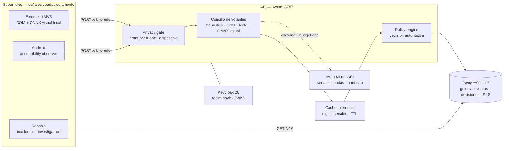

<div align="center">

<picture>
  <source media="(prefers-color-scheme: dark)" srcset="apps/website/public/brand/icon-paper.png">
  <source media="(prefers-color-scheme: light)" srcset="apps/website/public/brand/icon-ink.png">
  
</picture>

<h1>SOVIR</h1>

<p><strong>Digital Autonomy Intelligence</strong><br>
<em>See clearly. Decide freely.</em></p>

<p>
Escudo local-first contra estafas, suplantación, rastreo y diseño manipulativo —<br>
sensores consentidos, concilio de votantes y decisiones explicables, auditables y revocables.
</p>

<p>
<a href="https://github.com/HCHAPS404/SOVIR/actions/workflows/backend.yml"></a>
<a href="https://github.com/HCHAPS404/SOVIR/actions/workflows/ci.yml"></a>
<a href="https://github.com/HCHAPS404/SOVIR/actions/workflows/visual.yml"></a>
<a href="https://github.com/HCHAPS404/SOVIR/actions/workflows/deps-audit.yml"></a>
</p>

<p>


</p>

<p>
<a href="#qué-es-sovir">Producto</a> ·
<a href="#cómo-se-usa">Cómo se usa</a> ·
<a href="#estado-real">Estado real</a> ·
<a href="#arquitectura">Arquitectura</a> ·
<a href="#quickstart">Quickstart</a> ·
<a href="#documentación">Docs</a> ·
<a href="docs/product/PRODUCT_SPEC.md"><strong>Especificación maestra</strong></a>
</p>

</div>

---

> [!IMPORTANT]
> **Esto es un scaffold local-producción verificado, no un producto publicado.**
> El pipeline completo funciona en local hoy (sensor → consentimiento → concilio →
> decisión → consola), pero no hay instaladores, tiendas, multi-tenant real ni un
> modelo visual listo. Todo lo afirmado aquí tiene evidencia o se marca explícito
> como `NOT_IMPLEMENTED` / `NOT READY`. La especificación completa del producto
> objetivo vive en [`docs/product/PRODUCT_SPEC.md`](docs/product/PRODUCT_SPEC.md).

## Qué es SOVIR

Un **escudo de autonomía digital**: observa — con permiso explícito — lo que las
páginas y apps le piden al usuario, detecta mecanismos de ingeniería social y
fraude, y devuelve una decisión explicable. No es antivirus, no es un chatbot al
que pegar capturas, y no es vigilancia.

| | |
|---|---|
| **Consent-first** | Nada se observa sin grant por fuente y dispositivo; revocar detiene todo en el siguiente ciclo de evento. |
| **Local-first** | Señales tipadas y digests — nunca texto crudo, píxeles ni PII salen del dispositivo por defecto. |
| **Concilio, no oráculo** | Votantes independientes (heurística, ONNX texto, ONNX visual, remoto autorizado) emiten hipótesis con `votes[]` auditable; la política determinista decide. |
| **Explicable** | Cada veredicto lleva evidencia, procedencia e incertidumbre. Hechos ≠ hipótesis ≠ acciones. |
| **Coste gobernado** | Inferencia remota detrás de allowlist + hard cap de presupuesto; agotar tokens jamás apaga la protección local. |

## Qué detecta

El concilio reconoce hoy familias de señales tipadas, no texto libre:

| Familia | Ejemplos de señal |
|---|---|
| Urgencia y coerción | `URGENT_ACTION`, `EXTORTION_LANGUAGE`, `OFF_PLATFORM_MOVE` |
| Petición de secretos | `CREDENTIAL_REQUEST`, `SEED_PHRASE_REQUEST`, `PAYMENT_REQUEST` |
| Suplantación | `LINK_DESTINATION_MISMATCH`, `IDENTITY_UNVERIFIED`, `BRAND_IMPERSONATION` |
| Contexto visual | Logo/marca sobre fondo ajeno, UI que imita diálogos del sistema |

Cada señal es un hecho observable ("esta pantalla pide una contraseña"), nunca
una afirmación sobre la persona. La decisión sale de la combinación, no de una
señal sola.

## Cómo se usa

### Extensión de navegador

1. Carga la extensión (ver [Quickstart](#quickstart)). Chrome muestra **un único
   diálogo de instalación**: "leer datos en todos los sitios" — ese es el
   consentimiento amplio, una sola vez.
2. Desde ahí, la extensión observa la pestaña que estás viendo — cualquiera de
   ellas, sin preguntar de nuevo.
3. Si una página muestra señales de riesgo, aparece un aviso en el icono y en
   la consola, con explicación en lenguaje claro.
4. **Sitios sensibles protegidos por defecto**: banca, mensajería y redes
   sociales no se observan. El popup permite incluir uno concreto si lo decides
   ("Observarla de todos modos"), y excluir cualquier sitio normal con
   "No observar esta página".
5. En Opciones: interruptor maestro de pausa, lista de excepciones y de sitios
   sensibles editables.

### App Android

1. Instala el APK y abre la app. **La instalación no pide nada por sí sola.**
2. Inicia sesión o regístrate. Solo entonces aparece la pantalla
   "Activa tu protección", una sola vez, con los tres pasos:
   - **Observador de pantalla** — el servicio de accesibilidad de Android.
     El sistema operativo exige activarlo a mano en Ajustes; SOVIR no puede ni
     quiere evadirlo.
   - **Permiso de envío SOVIR** — grant explícito y con caducidad
     (24 h / 7 días / 30 días). Sin él, el observador no sube nada aunque la
     accesibilidad esté activa: dos puertas, no una.
   - **Notificaciones** — el diálogo estándar de Android, para que los avisos
     lleguen.
3. En funcionamiento, el observador lee metadatos de la pantalla que ves —
   **nunca texto íntegro, campos de contraseña ni capturas** — y emite señales
   tipadas. Las apps sensibles (banca, mensajería, redes) están excluidas por
   defecto y la lista es editable desde la propia app.
4. En **Cuenta** ves tus dispositivos ("Este teléfono · Móvil", "Ordenador"),
   cuándo observaron por última vez, y puedes **retirar** cualquiera.

### Consola web

El centro de control en el navegador: incidentes con su evidencia,
investigaciones, políticas activas, webhooks, presupuesto de análisis remoto y
exportación/borrado de datos. Todo lo que el móvil o la extensión observan se
refleja aquí, atado a tu cuenta y a cada dispositivo.

## Qué no hace SOVIR

| No es | Porque |
|---|---|
| Antivirus ni bloqueador | No toca el sistema ni otras apps; informa y avisa |
| Grabadora | No guarda texto, capturas ni pulsaciones — solo señales tipadas y digests |
| Vigilancia encubierta | Cada sensor exige un grant visible y revocable en cualquier momento |
| Perfilador | No infiere vulnerabilidades ni rasgos de la persona — evalúa la pantalla, no al usuario |

## Estado real

Lo que corre hoy, con la prueba que lo respalda:

| Pieza | Estado | Evidencia |
|---|:---:|---|
| API Rust (Axum) + PostgreSQL 17 | Verificado local | Migraciones 0001–0012, RLS activo, eventos reales persistidos |
| OIDC / Keycloak 26.4 | Verificado | JWT reales validados por JWKS (`JwksIdentityVerifier`), PKCE en clientes |
| Extensión (MV3) → backend | Verificado E2E | `live_check.mjs`: connect → observación → Postgres → `warn/high` → badge |
| ONNX en service worker | Verificado | `ort` 1.16.3 wasm, modelo visual 3.7 MB corre en el worker MV3 |
| Consentimiento | Verificado | Captura rechazada sin grant; renovación 24 h sin resucitar tombstones |
| Consola web | Verificado | Incidents, investigations, webhooks, backup cifrado, `/v1/metrics`, feedback |
| Android (Compose) | Verificado E2E | Login OIDC, observer de accesibilidad, grant, evento → intervención → notificación en vivo |
| Binding OIDC→dispositivo | Verificado | `x-sovir-device` sella eventos a su dispositivo; `last_seen` real en Cuenta |
| Sitio público (`apps/website`) | Servido local | Landing Umbral por funnel `/web` |
| URL pública estable | Activa | Tailscale Funnel → [`docs/operations/TAILSCALE_FUNNEL.md`](docs/operations/TAILSCALE_FUNNEL.md) |
| Modelo visual ONNX | **NOT READY** | Corre, pero 13 % FP benigno / ~3 % recall → [`model card`](ml/model-cards/sovir-onnx-visual.md) |
| iOS / Desktop | `NOT_IMPLEMENTED` | Scaffold UI solamente; sin toolchains en esta máquina |

## Superficies

| App | Stack | Rol | Estado |
|---|---|---|---|
| `apps/extension` | MV3 · TS · ONNX Runtime Web | Observador de navegador: señales DOM + visión local por sitio autorizado | Verificado en vivo |
| `apps/console` | Next.js · React | Centro de control: incidentes, investigaciones, políticas, webhooks, backup | Datos reales |
| `apps/website` | Next.js | Marketing público identidad Umbral | Servida |
| `apps/android` | Kotlin · Compose | Observador + consola móvil; tokens sellados con Keystore | Verificado E2E |
| `apps/desktop` | Tauri · React | Shell escritorio | `NOT_IMPLEMENTED` |
| `apps/ios` | SwiftUI | Cliente iOS | `NOT_IMPLEMENTED` (sin Xcode en Windows) |

## Arquitectura

Hexagonal local-first: el dominio nunca importa UI, SQL ni proveedores; la
inferencia remota es un puerto opcional detrás de presupuesto y allowlist.



| Capa | Crates / servicios |
|---|---|
| Dominio | `sovir-domain` — invariantes, sin efectos |
| Aplicación | `sovir-application` — casos de uso, decisión, consentimiento |
| Puertos | `sovir-ports` — traits de persistencia, inferencia, consentimiento |
| Adaptadores | `sovir-adapters`, `sovir-persistence` — Pg, ONNX, votantes, egress |
| Servicio | `services/api` — HTTP, auth, council, métricas |
| Contratos | `packages/contracts` OpenAPI `backend-dev.v0` + SDK TS generado |

## Quickstart

```powershell
# 1. Stack local — Postgres portable + Keycloak + API + frontends
scripts\db-dev.ps1       # Postgres portable + migraciones
scripts\api-dev.ps1      # API en :8787 (ver docs/operations/B21_LOCAL_DEV.md)

# 2. Gates backend
make backend-check        # cargo fmt/clippy/test + harness

# 3. Extension: chrome://extensions -> Developer mode -> Load unpacked -> apps/extension
#    Live-check automatizado (Chromium real, sin interaccion):
node apps/extension/scripts/live_check.mjs

# 4. Android (device con adb):
cd apps\android ; gradlew.bat installDebug
#    Servicio de accesibilidad: app.sovir.android/.observer.SovirAccessibilityService

# 5. Consola web:
cd apps\console ; npm run dev -- -p 3001
```

**Acceso público estable** (demo, PC encendido):
`https://hell.taile32c7d.ts.net` — `/` consola · `/api` API · `/sso` Keycloak · `/web` sitio.
Configuración y límites: [`docs/operations/TAILSCALE_FUNNEL.md`](docs/operations/TAILSCALE_FUNNEL.md).
*No es producción: es la máquina de desarrollo expuesta para pruebas reales.*

## Estructura del repositorio

```
apps/          extension · console · website · android · desktop · ios
crates/        sovir-domain · sovir-ports · sovir-application
               sovir-adapters · sovir-persistence          (hexagonal, Rust)
services/api   API HTTP + auth + council + metrics         (Axum)
packages/      contracts (OpenAPI backend-dev.v0) · ui-web · SDK TS
ml/            pipelines de entrenamiento · model cards
docs/          product (spec, ADRs) · backend · design · operations · ml
scripts/       arranque local, migraciones, harness, gates
infra/         postgres portable, keycloak realm
```

## Verificación

| Comando | Qué cubre |
|---|---|
| `python3 scripts/harness.py check` | Gates estáticos: contratos, secretos, estructura |
| `python3 scripts/harness.py eval` | Evaluaciones del concilio y detectores |
| `make backend-check` | cargo fmt · clippy · tests + harness |
| `node apps/extension/scripts/live_check.mjs` | E2E extensión → API → Postgres → badge, en Chromium real |
| `gradlew.bat testDebugUnitTest` (en `apps/android`) | Suite JVM del cliente Android |

Si una verificación no está implementada se reporta `NOT_IMPLEMENTED` — nunca `PASS`.

## Documentación

| Área | Documento |
|---|---|
| **Producto** | [Especificación maestra §0–§28](docs/product/PRODUCT_SPEC.md) · [ADRs](docs/adr/) |
| **Backend** | [Master plan](docs/backend/BACKEND_MASTER_PLAN.md) · [Bootstrap](docs/operations/BACKEND_BOOTSTRAP.md) · [ENV reference](docs/operations/ENV_REFERENCE.md) |
| **Frontend/diseño** | [Master plan](docs/design/FRONTEND_MASTER_PLAN.md) · [Gobernanza](docs/design/FRONTEND_GOVERNANCE.md) · [Figma workflow](docs/design/FIGMA_WORKFLOW.md) |
| **Operaciones** | [SLOs](docs/operations/SLOS.md) · [Tailscale Funnel](docs/operations/TAILSCALE_FUNNEL.md) · [Named tunnel](docs/operations/NAMED_TUNNEL_MIGRATION.md) · [Toolchains diferidos](docs/operations/DEFERRED_TOOLCHAINS.md) · [Branches](docs/operations/BRANCHES.md) |
| **ML** | [Model cards](ml/model-cards/) · [Pipelines](ml/pipelines/) · [docs/ml](docs/ml/) |
| **Agentes** | [AGENTS.md](AGENTS.md) · [CLAUDE.md](CLAUDE.md) · [.cursor/rules](.cursor/rules/) |
| **Auditoría** | [Auditoría pre-commit](docs/audits/AUDITORIA_PRECOMMIT_2026-10-27.md) |

## Roadmap

| Hito | Capacidad | Estado |
|---|---|---|
| H0–H1 | Fundación + core Rust + privacy gateway | Hecho |
| H2 | Sensores: extensión (hecho) · Android (hecho) · desktop/iOS | Parcial |
| H3 | Semantic delta + motor local | Parcial |
| H4 | Evidence graph + razonamiento remoto tipado | Parcial |
| H5 | Autonomy center + intervenciones | Parcial |
| H6 | Packs de dominio (FraudShield, MarketShield…) | Pendiente |
| H7 | Predicción adaptativa + cost engine | Parcial |
| H8 | Sync cifrada + collective intel + SDK | Pendiente |
| H9 | Hardening + comercialización | Pendiente |

Detalle y criterios de aceptación: [espec §23](docs/product/PRODUCT_SPEC.md#23-hitos-y-orden-de-implementación).

## Trabajo multiagente

Cuatro roles, un maintainer humano con autoridad final:

| Rol | Área | Reglas |
|---|---|---|
| **Claude Code** | Dominio/puertos Rust, ML, contratos | [CLAUDE.md](CLAUDE.md) |
| **Cursor** | Apps, UI, sensores OS | [.cursor/rules/](.cursor/rules/) |
| **Devin** | Servicios, infra, identidad, CI | [.devin/](.devin/) |
| **ChatGPT** | Arquitectura, ADRs, evals, auditoría | [.agents/skills/](.agents/skills/) |
| **Humano** | Merges, permisos, gasto, releases | [AGENTS.md](AGENTS.md) |

Un ticket = un owner + rutas editables + criterios verificables. Sin merges sin
revisión humana; sin atribución de agente en commits.

## Invariantes

- **Consentimiento específico y revocable** antes de cualquier observación.
- **Nada de texto crudo/píxeles/PII** en logs, fixtures, egress o Git.
- **Fail-closed**: revocado → detiene colección y transmisión.
- **Proveedor = puerto**; jamás dependencia del dominio.
- **Claims medidos o marcados** `NOT_IMPLEMENTED` — nunca inventados.

---

<div align="center">
<sub><strong>SOVIR</strong> — nombre de trabajo pendiente de validación legal ·
infraestructura protectora para que cada persona conserve el control de su vida digital.<br>
Reportes de seguridad: ver política en desarrollo · © 2026 SOVIR</sub>
</div>
