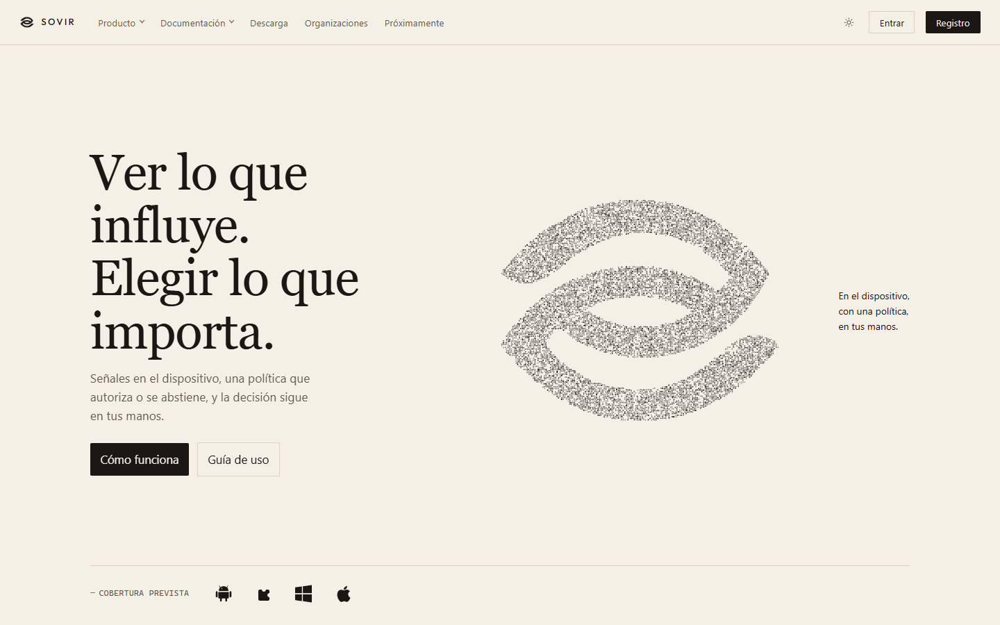
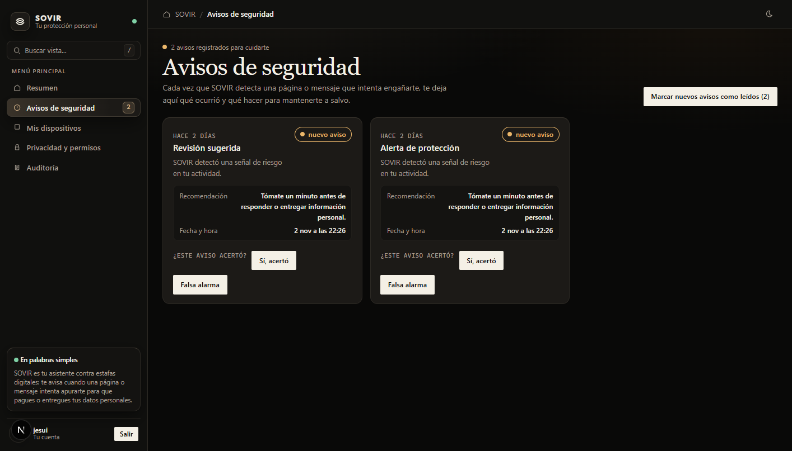
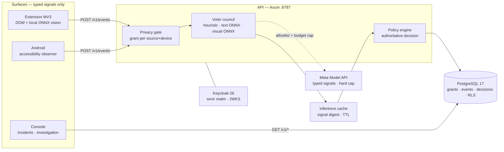

<div align="center">

<picture>
  <source media="(prefers-color-scheme: dark)" srcset="apps/website/public/brand/icon-paper.png">
  <source media="(prefers-color-scheme: light)" srcset="apps/website/public/brand/icon-ink.png">
  
</picture>

<h1>SOVIR</h1>

<p><strong>Digital Autonomy Intelligence</strong><br>
<em>See clearly. Decide freely.</em></p>

<p>
A local-first shield against scams, impersonation, tracking and manipulative design —<br>
consented sensors, a council of voters, and explainable, auditable, revocable decisions.
</p>

<p>
<a href="https://github.com/HCHAPS404/SOVIR/actions/workflows/backend.yml"></a>
<a href="https://github.com/HCHAPS404/SOVIR/actions/workflows/ci.yml"></a>
<a href="https://github.com/HCHAPS404/SOVIR/actions/workflows/visual.yml"></a>
<a href="https://github.com/HCHAPS404/SOVIR/actions/workflows/deps-audit.yml"></a>
</p>

<p>


</p>

<p>
<a href="#demo">Demo</a> ·
<a href="#what-is-sovir">Product</a> ·
<a href="#the-product-today">Screenshots</a> ·
<a href="#how-its-used">How it's used</a> ·
<a href="#real-status">Real status</a> ·
<a href="#architecture">Architecture</a> ·
<a href="#quickstart">Quickstart</a> ·
<a href="#documentation">Docs</a> ·
<a href="docs/product/PRODUCT_SPEC.md"><strong>Master specification</strong></a>
</p>

</div>

## Demo

<div align="center">

<!-- Pitch video hosted on YouTube. GitHub cannot embed YouTube players, so
     the thumbnail links to the video. Source script: docs/marketing/PITCH_3MIN_FINAL.md
     Recording pipeline: pitch/ -->
<a href="https://youtu.be/PdG3e74f0Fs">
  
</a>

<sub>**[Watch the 3-minute pitch on YouTube →](https://youtu.be/PdG3e74f0Fs)**<br>
Real surfaces, real reported scam pages: sign-in → live phishing observation in
Opera Air → typed signals → council decision → alerts in the console → consent
controls → extension popup → mobile experience. Script and recording pipeline:
[`docs/marketing/`](docs/marketing/) · [`pitch/`](pitch/)</sub>

</div>

---

> [!IMPORTANT]
> **This is a verified local-production scaffold, not a shipped product.**
> The full pipeline works locally today (sensor → consent → council →
> decision → console), but there are no installers, stores, real multi-tenancy
> or a production-ready visual model. Everything claimed here has evidence or
> is explicitly marked `NOT_IMPLEMENTED` / `NOT READY`. The full target-product
> specification lives in [`docs/product/PRODUCT_SPEC.md`](docs/product/PRODUCT_SPEC.md).

## What is SOVIR

A **digital-autonomy shield**: it observes — with explicit permission — what
pages and apps ask of the user, detects social-engineering and fraud
mechanisms, and returns an explainable decision. It is not an antivirus, not a
chatbot you paste screenshots into, and not surveillance.

| | |
|---|---|
| **Consent-first** | Nothing is observed without a per-source, per-device grant; revoking stops everything on the next event cycle. |
| **Local-first** | Typed signals and digests — raw text, pixels and PII never leave the device by default. |
| **Council, not oracle** | Independent voters (heuristic, text ONNX, visual ONNX, authorized remote) emit hypotheses with an auditable `votes[]`; the deterministic policy decides. |
| **Explainable** | Every verdict carries evidence, provenance and uncertainty. Facts ≠ hypotheses ≠ actions. |
| **Governed cost** | Remote inference behind allowlist + hard budget cap; running out of tokens never turns off local protection. |

## What it detects

The council recognizes families of typed signals today, not free text:

| Family | Example signals |
|---|---|
| Urgency and coercion | `URGENT_ACTION`, `EXTORTION_LANGUAGE`, `OFF_PLATFORM_MOVE` |
| Secret requests | `CREDENTIAL_REQUEST`, `SEED_PHRASE_REQUEST`, `PAYMENT_REQUEST` |
| Impersonation | `LINK_DESTINATION_MISMATCH`, `IDENTITY_UNVERIFIED`, `BRAND_IMPERSONATION` |
| Visual context | Brand/logo on a foreign background, UI mimicking system dialogs |

Every signal is an observable fact ("this screen asks for a password"), never
a claim about the person. The decision comes from the combination, not from a
single signal.

## The product today

| Public site — `apps/website` | Console — security notices |
|---|---|
|  |  |

<sub>Console screenshots use the seeded local dev principal (`jesui`) — a
development-only identity for the local stack, not a person or collaborator.</sub>

## How it's used

### Browser extension

1. Load the extension (see [Quickstart](#quickstart)). Chrome shows **one
   install dialog**: "read data on all sites" — that is the broad consent,
   once.
2. From then on, the extension observes the tab you are viewing — any of
   them, without asking again.
3. If a page shows risk signals, a notice appears on the icon and in the
   console, explained in plain language.
4. **Sensitive sites protected by default**: banking, messaging and social
   networks are not observed. The popup lets you include a specific one if
   you choose ("Observe it anyway"), and exclude any normal site with
   "Don't observe this page".
5. In Options: master pause switch, editable exception list and sensitive-site
   list.

### Android app

1. Install the APK and open the app. **Installation asks for nothing by itself.**
2. Sign in or register. Only then does the "Activate your protection" screen
   appear, once, with the three steps:
   - **Screen observer** — the Android accessibility service. The OS requires
     enabling it by hand in Settings; SOVIR cannot and will not bypass that.
   - **SOVIR send permission** — explicit, expiring grant
     (24 h / 7 days / 30 days). Without it, the observer uploads nothing even
     with accessibility on: two gates, not one.
   - **Notifications** — the standard Android dialog, so alerts reach you.
3. While running, the observer reads metadata of the screen you see —
   **never full text, password fields or screenshots** — and emits typed
   signals. Sensitive apps (banking, messaging, social) are excluded by
   default and the list is editable inside the app.
4. In **Account** you see your devices ("This phone · Mobile", "Computer"),
   when each last observed, and you can **remove** any of them.

### Web console

The control center in your browser: incidents with their evidence,
investigations, active policies, webhooks, remote-analysis budget and data
export/erasure. Everything the phone or the extension observes shows up here,
bound to your account and to each device.

## What SOVIR does not do

| It is not | Because |
|---|---|
| Antivirus or blocker | It does not touch the system or other apps; it informs and warns |
| A recorder | It stores no text, screenshots or keystrokes — only typed signals and digests |
| Covert surveillance | Every sensor requires a visible grant, revocable at any time |
| A profiler | It infers no vulnerabilities or traits of the person — it evaluates the screen, not the user |

## Real status

What runs today, with the evidence behind it:

| Piece | Status | Evidence |
|---|:---:|---|
| Rust API (Axum) + PostgreSQL 17 | Verified local | Migrations 0001–0013, RLS active, real events persisted |
| OIDC / Keycloak 26.4 | Verified | Real JWTs validated via JWKS (`JwksIdentityVerifier`), PKCE in clients |
| Extension (MV3) → backend | Verified E2E | `live_check.mjs`: connect → observation → Postgres → `warn/high` → badge |
| ONNX in service worker | Verified | `ort` 1.16.3 wasm, 3.7 MB visual model runs in the MV3 worker |
| Consent | Verified | Capture rejected without grant; 24 h renewal without resurrecting tombstones |
| Web console | Verified | Incidents, investigations, webhooks, encrypted backup, `/v1/metrics`, feedback |
| Android (Compose) | Verified E2E | OIDC login, accessibility observer, grant, event → intervention → live notification |
| OIDC→device binding | Verified | `x-sovir-device` seals events to their device; real `last_seen` in Account |
| Public site (`apps/website`) | Served locally | Umbral landing via funnel `/web` |
| Stable public URL | Active | Tailscale Funnel → [`docs/operations/TAILSCALE_FUNNEL.md`](docs/operations/TAILSCALE_FUNNEL.md) |
| Visual ONNX model | **NOT READY** | Runs, but 13% benign FP / ~3% recall → [`model card`](ml/model-cards/sovir-onnx-visual.md) |
| iOS / Desktop | `NOT_IMPLEMENTED` | Scaffold UI only; no toolchains on this machine |

## Surfaces

| App | Stack | Role | Status |
|---|---|---|---|
| `apps/extension` | MV3 · TS · ONNX Runtime Web | Browser observer: DOM signals + local vision on authorized sites | Verified live |
| `apps/console` | Next.js · React | Control center: incidents, investigations, policies, webhooks, backup | Real data |
| `apps/website` | Next.js | Umbral-identity public marketing | Served |
| `apps/android` | Kotlin · Compose | Observer + mobile console; Keystore-sealed tokens | Verified E2E |
| `apps/desktop` | Tauri · React | Desktop shell | `NOT_IMPLEMENTED` |
| `apps/ios` | SwiftUI | iOS client | `NOT_IMPLEMENTED` (no Xcode on Windows) |

## Architecture

Hexagonal local-first: the domain never imports UI, SQL or providers; remote
inference is an optional port behind budget and allowlist.



| Layer | Crates / services |
|---|---|
| Domain | `sovir-domain` — invariants, no effects |
| Application | `sovir-application` — use cases, decision, consent |
| Ports | `sovir-ports` — traits for persistence, inference, consent |
| Adapters | `sovir-adapters`, `sovir-persistence` — Pg, ONNX, voters, egress |
| Service | `services/api` — HTTP, auth, council, metrics |
| Contracts | `packages/contracts` OpenAPI `backend-dev.v0` + generated TS SDK |

## Quickstart

```powershell
# 1. Local stack — portable Postgres + Keycloak + API + frontends
scripts\db-dev.ps1       # portable Postgres + migrations
scripts\api-dev.ps1      # API on :8787 (see docs/operations/B21_LOCAL_DEV.md)

# 2. Backend gates
make backend-check        # cargo fmt/clippy/test + harness

# 3. Extension: chrome://extensions -> Developer mode -> Load unpacked -> apps/extension
#    Automated live check (real Chromium, no interaction):
node apps/extension/scripts/live_check.mjs

# 4. Android (device over adb):
cd apps\android ; gradlew.bat installDebug
#    Accessibility service: app.sovir.android/.observer.SovirAccessibilityService

# 5. Web console:
cd apps\console ; npm run dev -- -p 3001
```

**Stable public access** (demo, PC powered on):
`https://hell.taile32c7d.ts.net` — `/` console · `/api` API · `/sso` Keycloak · `/web` site.
Configuration and limits: [`docs/operations/TAILSCALE_FUNNEL.md`](docs/operations/TAILSCALE_FUNNEL.md).
*Not production: it is the development machine exposed for real testing.*

## Repository layout

```
apps/          extension · console · website · android · desktop · ios
crates/        sovir-domain · sovir-ports · sovir-application
               sovir-adapters · sovir-persistence          (hexagonal, Rust)
services/api   HTTP API + auth + council + metrics         (Axum)
packages/      contracts (OpenAPI backend-dev.v0) · ui-web · TS SDK
ml/            training pipelines · model cards
docs/          product (spec, ADRs) · backend · design · operations · ml
scripts/       local startup, migrations, harness, gates
infra/         portable postgres, keycloak realm
```

## Verification

| Command | What it covers |
|---|---|
| `python3 scripts/harness.py check` | Static gates: contracts, secrets, structure |
| `python3 scripts/harness.py eval` | Council and detector evaluations |
| `make backend-check` | cargo fmt · clippy · tests + harness |
| `node apps/extension/scripts/live_check.mjs` | E2E extension → API → Postgres → badge, real Chromium |
| `gradlew.bat testDebugUnitTest` (in `apps/android`) | Android client JVM suite |

Any check that is not implemented is reported `NOT_IMPLEMENTED` — never `PASS`.

## Documentation

| Area | Document |
|---|---|
| **Product** | [Master specification §0–§28](docs/product/PRODUCT_SPEC.md) · [ADRs](docs/adr/) |
| **Backend** | [Master plan](docs/backend/BACKEND_MASTER_PLAN.md) · [Bootstrap](docs/operations/BACKEND_BOOTSTRAP.md) · [ENV reference](docs/operations/ENV_REFERENCE.md) |
| **Frontend/design** | [Master plan](docs/design/FRONTEND_MASTER_PLAN.md) · [Governance](docs/design/FRONTEND_GOVERNANCE.md) · [Figma workflow](docs/design/FIGMA_WORKFLOW.md) |
| **Operations** | [SLOs](docs/operations/SLOS.md) · [Performance baseline](docs/operations/PERFORMANCE_BASELINE.md) · [Payments options](docs/operations/PAYMENTS_OPTIONS.md) · [Requires human](docs/operations/REQUIRES_HUMAN.md) · [Tailscale Funnel](docs/operations/TAILSCALE_FUNNEL.md) · [Named tunnel](docs/operations/NAMED_TUNNEL_MIGRATION.md) · [Deferred toolchains](docs/operations/DEFERRED_TOOLCHAINS.md) · [Branches](docs/operations/BRANCHES.md) |
| **ML** | [Model cards](ml/model-cards/) · [Pipelines](ml/pipelines/) · [docs/ml](docs/ml/) |
| **Audit** | [Pre-commit audit](docs/audits/AUDITORIA_PRECOMMIT_2026-10-27.md) |
| **Marketing** | [Pitch video scripts](docs/marketing/PITCH_VIDEO_SCRIPTS.md) · [3-min final script](docs/marketing/PITCH_3MIN_FINAL.md) · [recording pipeline](pitch/) |

## Roadmap

| Milestone | Capability | Status |
|---|---|---|
| H0–H1 | Foundation + Rust core + privacy gateway | Done |
| H2 | Sensors: extension (done) · Android (done) · desktop/iOS | Partial |
| H3 | Semantic delta + local engine | Partial |
| H4 | Evidence graph + typed remote reasoning | Partial |
| H5 | Autonomy center + interventions | Partial |
| H6 | Domain packs (FraudShield, MarketShield…) | Pending |
| H7 | Adaptive prediction + cost engine | Partial |
| H8 | Encrypted sync + collective intel + SDK | Pending |
| H9 | Hardening + commercialization | Pending |

Detail and acceptance criteria: [spec §23](docs/product/PRODUCT_SPEC.md#23-hitos-y-orden-de-implementación).

## Invariants

- **Specific, revocable consent** before any observation.
- **No raw text/pixels/PII** in logs, fixtures, egress or Git.
- **Fail-closed**: revoked → collection and transmission stop.
- **Provider = port**; never a domain dependency.
- **Claims measured or marked** `NOT_IMPLEMENTED` — never invented.

## License

[MIT](LICENSE) © 2026 SOVIR contributors — use it, fork it, build on it.

---

<div align="center">
<sub><strong>SOVIR</strong> — working name pending legal validation ·
protective infrastructure so every person keeps control of their digital life.<br>
Security reports: see policy in development · © 2026 SOVIR</sub>
</div>
